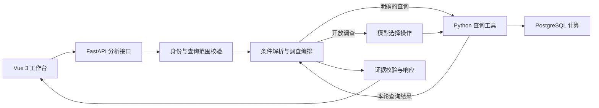

# 电商履约分析 Agent 技术架构

本文规定首版的统计实现、接口、权限和调查编排。用户行为和验收编号见 [PRD](PRD.md)，实现顺序见 [Roadmap](Roadmap.md)，回归用例见[验收参考](开发规范.md#验收参考)。

## 1. 总体结构



- **FastAPI + Pydantic** 负责请求响应、参数校验和权限边界。**Python 编排器**调用支持工具调用的模型，负责循环、预算和停止条件。模型入口采用 OpenAI 兼容接口，启动前用目标模型验证工具参数及结果回传。 [FastAPI 请求体](https://fastapi.tiangolo.com/tutorial/body/) · [Pydantic 模型](https://docs.pydantic.dev/latest/concepts/models/) · [Python SDK](https://github.com/openai/openai-python)
- **PostgreSQL + psycopg 3** 负责过滤、分组、计数和时长计算。同一组查询函数供 API、手动下钻、规则调查和模型调查复用。 [psycopg 参数化查询](https://www.psycopg.org/psycopg3/docs/basic/params.html)
- **Vue 3** 维护页面对话、加载状态和证据展开动作。后端记录有效查询条件与归属，并在返回后给前端真实轨迹。首版用同步 HTTP。 [Vue 官方指南](https://vuejs.org/guide/introduction.html)

建议工程布局如下。后续按值对象与功能边界拆文件即可。

```text
compose.yaml            本地 PostgreSQL、初始化、FastAPI 和 Vue 静态工作台
.env.example            本地配置示例
backend/
  pyproject.toml        Python 依赖与工具配置
  app/
    __init__.py
    main.py             API 入口
    schemas.py          API 请求、响应与公共结果类型
    auth.py             身份、会话归属与查询范围
    queries.py          参数化 SQL 与统计查询
    analysis.py         单步查询、规则调查、模型调查
    tools/
      __init__.py
      delivery.py       两个履约工具的定义与执行入口
  migrations/           数据与权限结构
  scripts/import_olist.py
  tests/
frontend/
  src/App.vue
  src/api/analysis.ts
eval/
  cases/
  reference_sql/
  reports/
```

## 2. 数据存储与导入（FR-01、FR-02、NFR-02）

### 数据对象

| 对象 | 最少字段和约束 |
| --- | --- |
| 数据版本 `dataset_version` | 数据版本 ID、来源、订单 CSV 与客户 CSV 各自的原始文件 SHA-256、导入时间、覆盖月份、阶段数据能力和数据质量计数。合成数据与 Olist 使用各自版本 ID。 |
| 订单分析表 `order_fact` | `dataset_id`、`order_id`、`order_status`、`purchased_at`、`estimated_delivery_date`、`delivered_at`、`handed_to_carrier_at`、`state_code`、`city_name`。主键为 `(dataset_id, order_id)`。 |
| 会话与分析记录 | 会话所属账号、数据版本、已确认查询条件。分析记录保存分析 ID、状态、经核实的证据和轨迹。 |
| 查询证据 | 证据 ID、所属分析、数据版本、口径版本、有效条件、返回行和完成时间。用于答复回填以及从某次结果下钻。 |

1. 用 Python 读 `olist_orders_dataset.csv` 与 `olist_customers_dataset.csv`，按 `customer_id` 关联。关联键仅用于导入。州代码规范为大写，城市在州内识别。
2. 订单 CSV 的必需列为 `order_id`、`customer_id`、`order_status`、`order_purchase_timestamp`、`order_estimated_delivery_date` 和 `order_delivered_customer_date`。客户 CSV 的必需列为 `customer_id`、`customer_state` 和 `customer_city`。缺必需列、订单 ID 重复或客户关联键重复时拒绝导入并报告位置。未匹配到客户的订单保留为地区未知。总部整体统计包含这些订单，按州查询时单列“未知地区”，该组只展示汇总。州账号仅查询自己州的订单。
3. 保留源时间的日期和时间语义。预计送达用日期，源事件时间按无时区历史时间戳解析。空白或无法解析的可空事件时间记空，并记录相应质量计数。缺失或无法解析的下单时间使该行不可归月，拒绝发布该数据版本并反馈质量错误。交接列 `order_delivered_carrier_date` 可选。整列缺失时，订单仍可导入并执行常规统计，同时将版本标记为缺少阶段数据能力。列存在但值为空、无效或顺序异常时按行剔除。
4. 以来源、订单文件原始字节的 SHA-256 和客户文件原始字节的 SHA-256 共同唯一标识一个文件导入版本。通过数据库唯一约束和事务处理并发重试。两次成功导入同一对输入返回同一个版本 ID，订单数一致。校验与写入随事务提交一起发布，失败导入保留可用旧版本。
5. 查询先按数据版本和下单月份筛选，常用索引覆盖版本、下单时间及收货州。月份统一用半开区间，分组字段通过枚举映射到静态 SQL。

Olist 官方元数据标注 CC BY-NC-SA 4.0。源码仓库提供来源、下载和导入说明，公开演示以合成数据为默认。 [Olist 数据](https://www.kaggle.com/datasets/olistbr/brazilian-ecommerce) · [许可文本](https://creativecommons.org/licenses/by-nc-sa/4.0/)

### 计算与无数据语义

- 超期条件为 `DATE(delivered_at) > estimated_delivery_date`。先筛状态为已送达且两日期齐全。单次与两次查询使用同一口径。跨月签收仍归到下单月份。
- `late_rate` 的 `value` 返回 0 到 1 的比率，附 `numerator` 和 `sample_count`。变化字段 `delta_pp` 返回百分点。分母为零时 `value` 与 `delta_pp` 为 `null`。已送达订单数为零时返回数值 0。
- `avg_delivery_days` 从已送达订单中选择下单与签收时间齐全且 `purchased_at <= delivered_at` 的记录。按实际耗时秒数除以 `86400` 转为天数，再计算均值及有效样本数。无样本时返回 `null` 和样本数 0。
- 阶段统计从超期率有效样本中筛选 `purchased_at <= handed_to_carrier_at <= delivered_at` 的订单，两段使用同一个有效样本集合。按实际耗时计算天数，使用 `percentile_cont(0.5)` 和 `percentile_cont(0.9)`，并输出有效样本数及相对于超期率样本的剔除数。每期独立取样。[PostgreSQL 分位数](https://www.postgresql.org/docs/current/functions-aggregate.html)
- 计算与排序保留精度，显示层才四舍五入。按地区比较保留两期分组键的并集，将缺失一期表示为零样本。明确看超期单数增量时，两期单数相减。明确看超期率变化时，任何一期分母为零的地区没有有效百分点差值。
- 默认展示标题明确区分“超期单数净增”和“超期率变化”。例如全部地区净增 185 单，与各州正增量合计 233 单是不同的统计量。样本不足时显示样本数，模型可将其列为待核实线索。

Olist 全部地区的阶段耗时回归参考如下。7 月和 8 月分别有 6,119 和 6,306 个阶段有效样本。交接前中位耗时由 1.80 天降至 1.77 天，交接后由 5.30 天降至 4.94 天。同期超期率上升，答复应明确区分典型订单耗时和超过预计送达日期的比例。 [Olist 数据集](https://www.kaggle.com/datasets/olistbr/brazilian-ecommerce)

## 3. 分析接口（FR-03、FR-05、FR-07）

### `POST /api/analysis`

认证身份由 FastAPI 取得并校验。第一次请求可以省略 `session_id`，响应返回新会话 ID。已有会话绑定账号和数据版本。首次请求未指定数据版本时，使用运行模式配置的已发布默认版本。切换数据版本时开启新会话。

`GET /api/workspace` 返回当前演示身份、运行模式和已发布数据版本。覆盖月份和订单数按当前账号可见范围显示。会话、分析与证据保存在单个 API 进程内，由当前账号与会话共同校验访问。

| 请求模式 | 必需输入 | 解析规则 |
| --- | --- | --- |
| `question` | `question`，新会话可选已发布的 `dataset_id`，已有会话传 `session_id`，可传 `ui_defaults` | 先读本轮的明确要求，再沿用已确认的会话条件，最后使用用户可见的页面默认条件。 |
| `drilldown` | `session_id`、`source_evidence_id`、`state` | 验证证据归属、版本和该州是否存在于查询结果。以该证据的原月份和指标执行 `group_by=city`，并重新检查当前权限。 |

`ui_defaults` 可包含页面明确展示的 `year`、`month`、`baseline_month` 和 `metric`，由后端校验。按本轮明确条件、同一会话中仍适用的已确认条件、页面可见默认值的顺序补全。答复标明继承和默认的条件。由上一轮目标月推导出的基准月随该目标月一起使用。对选定目标月与基准月的比较，差值按目标月减基准月。

- 单月查数或直接查询单月阶段耗时只需目标月。已确认年份和指标的“8 月是不是变差”，在缺少其他可用基准月时以 7 月为基准。明确要求“与上月比”也按目标月推算上一个自然月。
- 明确要求两期比较但缺少可推断的另一时期，或者缺年份、指标等必要条件时，本轮集中询问，统计调用数为零。同一会话继续补充条件后重新判断是否可执行。

响应统一返回 `session_id`、`analysis_id`、`status`、`answer`、`effective_query`、`evidence`、`trace` 和 `pending_fields`。每条证据包含口径版本、有效月份与地区以及实际统计值。每个查询轨迹记录顺序、工具名、规范化参数、状态、耗时和关联证据 ID。

| 状态 | 返回语义 |
| --- | --- |
| `answered` | 查询已完成，包括有效结果为 0 的计数。 |
| `needs_clarification` | 缺少必要业务条件，列出需要用户确认的信息。 |
| `scope_denied` | 请求范围超出授权，提示可查范围。 |
| `no_data` | 查询执行成功，所需周期均无可计算样本。有效计数 0 按 `answered` 返回。 |
| `unsupported` | 数据源缺少回答所需的字段或数据能力，且本轮没有可用的部分证据。 |
| `partial` | 已有可用证据，但比较缺一期样本，或后续受缺字段、错误或执行预算限制。返回已核实结果和需补充的部分。 |
| `unavailable` | 本轮因执行故障、预算耗尽或调查提前结束而未取得可支持答复的证据，例如受理预算内的请求全部被拒。 |

分组结果中个别地区缺一期样本时保留该地区并显示 `null`，整体状态按请求所需的查询结果判断。直接查阶段时，数据版本缺交接列返回 `unsupported`，交接列存在且所需周期均无有效阶段样本返回 `no_data`。涉及相关查询且已有部分证据时按 `partial` 返回。

业务结果返回 HTTP 200。`unavailable` 使用 HTTP 503。若数据库连接或版本读取在创建会话前失败，结构化响应中的 `session_id` 为 `null`。未认证请求返回 401，其他账号的会话或证据按资源不可用返回 404，协议层无效参数返回 422。有效问题中的越权范围使用业务状态 `scope_denied`。

追问具体承运商时，答复说明所需的承运商标识与物流轨迹。同一会话中已有符合时期和地区条件的地区证据时，返回 `partial` 并引用原证据。缺少匹配证据时返回 `unsupported`。两种情况均无需新增统计查询。

一次州内城市下钻的请求可写成下面这样。

```json
{
  "mode": "drilldown",
  "session_id": "s_demo",
  "source_evidence_id": "ev_states_2018_08",
  "state": "SP"
}
```

Vue 通过状态控制加载、待确认、结果和失败提示。回答与证据来自同一个响应。若用户切换会话、账号或发起更新请求，前端依据当前请求标识阻止旧响应覆盖新的页面状态。

## 4. 两个查询工具（FR-02、FR-04）

工具注册表只包含下列两个只读函数。Pydantic 模型提供工具入参的 JSON Schema，执行前仍由服务端验证。模型提交的地区是请求，服务端登录身份决定授权范围。

| 工具 | 参数 | 单次返回 |
| --- | --- | --- |
| `compare_delivery` | `month`、可选 `baseline_month`、`metric`、可选 `state`、`group_by` | 单月或两月统计，含有效样本数。超期率额外带超期单数、比率、百分点变化和超期单增量。 |
| `compare_delivery_stages` | `month`、可选 `baseline_month`、可选 `state` | 单月或两月的交接前后阶段中位数、P90、有效样本数及剔除数。 |

`metric` 取 `late_rate`、`delivered_count` 或 `avg_delivery_days`。`group_by` 取 `none`、`state` 或 `city`，其中 `city` 需要具体州。`month` 格式为 `YYYY-MM`，数据版本由当前会话选定。用户明确指定全国时，在调用工具前校验全国权限。未指定州时，工具基于当前账号的有效可见范围查询。

每次工具只完成参数约定的一个统计问题，返回后由编排器决定是否再查。参数中的月份使用 SQL 参数绑定，分组、指标和排序使用受控映射，模型提供的字符串不作为 SQL 语句执行。阶段分析可定位差异所在链路，数据缺少承运商身份和全轨迹时输出待补证据。 [psycopg 参数化查询](https://www.psycopg.org/psycopg3/docs/basic/params.html)

## 5. 编排、终态与权限（FR-03、FR-04、FR-06、FR-07、NFR-01）

1. **确认条件。** 解析问题，形成指标、时间、范围和查询目的。需要澄清或显式越权时，直接返回对应状态。
2. **执行明确查询。** 单月查数、只比较是否变差、直接查阶段和手动下钻按有效条件调用一次查询。结果由 Python 服务组装。
3. **开放调查。** 使用现有证据让模型选择允许的工具或停止。Python 按工具调用次序校验参数、查权限、扣预算和执行，并按原工具调用 ID 回传实际结果。模型可以在查完州后选择城市或阶段，也可以提前结束。
   兼容 Chat Completions 的多轮工具调用保留上一轮模型消息的 `content`、供应商返回的 `reasoning_content` 和 `tool_calls`。这些字段用于同一次调查的模型请求历史，工作台收到的是经核验的查询证据和轨迹。[百炼工具调用](https://help.aliyun.com/zh/model-studio/qwen-function-calling)
4. **收束证据。** 每条消息最多 3 次工具请求，在预算内收到的非法或重复请求也占用名额。用完预算后可用一次模型调用组织结论，工具保持关闭。证据足以完成任务时返回 `answered`，证据不足但已有可用结果时返回 `partial`。重复查询或后续依赖故障也会结束查询计划，模型失败时用已有结果组装答复。HTTP、模型和 SQL 都设可配置的超时，依赖故障、预算耗尽或调查早停时，按响应状态表区分有部分证据和无可用证据的结果。
5. **回填数字。** 模型可选择证据 ID 和需要解释的字段。服务端从对应记录回填数字和范围。复用历史证据时校验其会话归属、版本、范围和相关性。结论中的承运商、仓库责任需要单独证据，缺字段时只输出对应范围内的观察和待查项。

规则版对明确请求直接执行。开放调查先用一次查询看授权范围内的整体变化，根据结果和用户目的决定是否继续。

- 总部调查地区变化时，整体变化明显再按州拆分。正增量集中且样本足够时查该州城市。变化分散时可用剩余预算检查阶段耗时。
- 州账号直接从已授权州的整体结果决定是否按州内城市拆分或查本州阶段。后续执行沿用服务端确认的州范围。
- 集中度为已知州最大正增量除以已知州正增量之和。分母为零时停止集中度判断。未知地区的变化单列。冻结阈值为 **60%**，Olist 示例为 185/233，约 **79.4%**。
- 整体判断使用超期率上升至少 **2 个百分点**，且两期各有至少 **5 个**有效样本。总部确认某州正增量集中后，使用相同的样本要求决定城市下钻。M4 比较 27 组阈值后沿用 M2 开发初值。两版复用统计工具、授权边界和每轮工具预算。[校准记录](../eval/results/m4-calibration/calibration.json)

### 权限和审计

- 建表与导入使用独立的维护角色。业务查询使用只读数据库角色，分别覆盖总部与授权州。查询角色无表所有权、超级用户权限和 `BYPASSRLS`。
- 应用根据已认证账号在固定角色映射中选择连接或连接池。读取、比较、下钻和读取历史证据都验证归属。数据库行策略兜底，州角色条件用授权州匹配。账号值和州隔离不依赖模型。
- `order_fact` 的总部策略覆盖全部地区，SP 策略只匹配 `state_code = 'SP'`。查询登录只取得分析需要的列。SP 工作台的月份和总单数从行策略可见的事实行计算。API 在执行查询前验证所用角色和行策略有效。
- 分析轨迹记录时间、查询状态、工具请求序号、有效范围和证据 ID。若需写入分析记录，使用具有相应写权限的服务角色，订单查询连接仍保持只读。日志和模型结果只暴露必要的聚合数据，凭据与原始客户标识留在服务侧。 [PostgreSQL 行级安全](https://www.postgresql.org/docs/current/ddl-rowsecurity.html)

## 6. 运行方式（NFR-03）

- **本地合成演示**默认使用合成数据和规则调查，可切换为固定模型输出重放工具调用。两种路径均可覆盖查看数字、下钻、缺证据和权限受限，页面标出当前数据和执行模式。
- **Olist 复算**通过导入脚本发布数据版本，用参考 SQL 检查 PRD 的样例，再用同一接口查询给前端。
- **真实模型评测**设置可用的模型地址、凭据、模型名和超时。记录运行版本与配置，用可重复的题集跑结果。默认回归可以独立运行。
